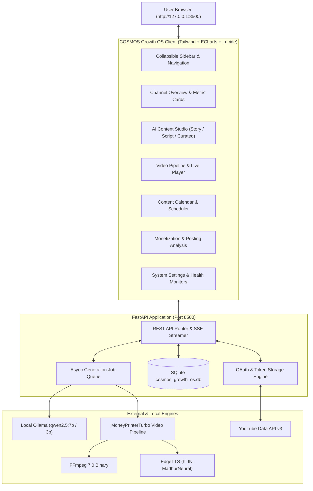

# COSMOS GROWTH OS — MASTER IMPLEMENTATION PLAN
**Platform**: Premium YouTube Analytics, AI Content Studio, Scheduling & Automation Platform
**Target Channel**: COSMOS VIRAL (@cosmos-1nr)
**Environment**: Windows 11 64-bit | Intel Core i9-13900H | 32 GB RAM | Local Ollama (`qwen2.5:7b`, `qwen2.5:3b`) | MoneyPrinterTurbo Portable 1.3.9 | FFmpeg 7.0
**Document Version**: 1.0.0
**Author**: COSMOS Growth OS Engineering & Architecture Team

---

## 1. Executive Summary & Product Vision

**COSMOS GROWTH OS** is an integrated, local-first command center engineered specifically for the YouTube Shorts channel **COSMOS VIRAL**. It unifies:
1. **Real-time YouTube Data & Analytics**: Live subscriber counts, view telemetry, engagement ratios, and official YouTube Partner Program (YPP) monetization milestones.
2. **AI Content Studio**: Powered by local Ollama LLMs (`qwen2.5:7b` & `3b`), providing Story Conception Mode, Exact Script Mode, Curated Mystery Catalogs, and algorithmic quality & policy checking.
3. **Automated Video Production Pipeline**: Automated visual asset sourcing, EdgeTTS Hindi neural voice synthesis (`hi-IN-MadhurNeural`), synchronized subtitle rendering, dynamic pacing calculation (guaranteeing zero clip repetition and zero black fade artifacts), and automated 1080x1920 thumbnail generation.
4. **Content Calendar & Scheduling**: Visual release planner, approval gates, and secure YouTube upload pipeline (strictly private test uploads by default; public releases require explicit authorization).
5. **Zero-Cost / Free-First Architecture**: Operates 100% on free, open-source, and official free APIs without recurring cloud subscriptions or hidden costs.

---

## 2. Environment & Codebase Audit

### 2.1 Hardware & Operating System
- **Host**: Windows 11 Home/Pro 64-bit on Infinix ZERO BOOK 13
- **CPU**: Intel Core i9-13900H (14 cores / 20 threads) — exceptional local LLM and video encoding performance
- **Memory**: 32 GB LPDDR5 RAM
- **Graphics**: Intel Iris Xe Graphics
- **Python**: Portable Python 3.10 embedded at `lib\python\python.exe`
- **FFmpeg**: Standalone binary at `lib\ffmpeg\ffmpeg-7.0-essentials_build\ffmpeg.exe`
- **Local LLM**: Ollama daemon at `http://localhost:11434` with `qwen2.5:7b` (4.7 GB) and `qwen2.5:3b` (1.9 GB) verified active.

### 2.2 Existing Assets & Working Code
- `MoneyPrinterTurbo/`: Core open-source media download and assembly engine.
- `cosmos_shorts/cosmos_generator.py`: Ollama prompt engineering for Hindi narration and keyword extraction.
- `cosmos_shorts/cosmos_orchestrator.py`: Orchestrator enforcing 1-to-1 keyword-to-clip duration mapping:
  $$\text{optimal\_clip\_duration} = \max\left(5, \left\lceil \frac{\text{audio\_duration}}{\text{num\_keywords}} \right\rceil\right)$$
- `cosmos_shorts/cosmos_thumbnail_builder.py`: Pillow-based 1080x1920 thumbnail engine with high-contrast badge and Devanagari typography.
- `cosmos_shorts/cosmos_youtube_uploader.py`: Google OAuth2 v3 uploader with valid `token.json` and channel `@cosmos-1nr` authenticated (49 subscribers, 11,340 views, 37 videos).
- `cosmos_shorts/cosmos_topics.json`: 8 high-performing Hindi mystery categories.

---

## 3. Architecture Decision

### 3.1 The Frontend/Backend Architecture
- **Backend**: FastAPI running on Python 3.10 portable.
  - Asynchronous endpoints, typed Pydantic models, SQLite database with thread-safe connection pooling, Server-Sent Events (SSE) for real-time video rendering progress.
- **Frontend**: Single-Page Application (SPA) served directly by FastAPI static assets.
  - **Technology**: Modern HTML5, ES Modules, Tailwind CSS design system tokens, Lucide Iconography, and Apache ECharts for interactive visualizations.
  - **Rationale**: The user environment does not have Node.js / npm installed globally. Using an ES module SPA backed by FastAPI static hosting guarantees 100% standalone execution on Windows without requiring Node.js installation, zero build-step fragility, sub-second boot times, and instant local hot-reloads.
- **Data Persistence**: SQLite database (`cosmos_growth_os.db`) storing channel telemetry, video archives, generation jobs, scheduled items, and user preferences.



---

## 4. UI/UX Design System Tokens

### 4.1 Color Palette
- **Background**: Deep Charcoal / Cosmic Navy (`#0B0F19`)
- **Card Surfaces**: Dark Slate (`#111827`) with subtle border (`#1F2937`)
- **Primary Text**: Bright White (`#F9FAFB`)
- **Muted Text**: Cool Gray (`#9CA3AF`)
- **Brand Accent**: Electric Violet (`#8B5CF6`) & Cyan Glow (`#06B6D4`)
- **Positive / Growth**: Emerald Green (`#10B981`)
- **Warning / Alert**: Vivid Amber (`#F59E0B`)
- **Error / Negative**: Crimson Rose (`#EF4444`)

### 4.2 Spacing & Typography
- **Grid Scale**: 4px base scale (e.g., `p-4`, `p-6`, `gap-6`)
- **Border Radius**: Subtle modern curved borders (`rounded-xl` for cards, `rounded-lg` for buttons)
- **Typography**: Inter / Outfit sans-serif with Hindi Devanagari font fallback (Noto Sans Devanagari)

---

## 5. Database Design (SQLite Schema)

```sql
-- Connected YouTube Channels
CREATE TABLE IF NOT EXISTS channels (
    channel_id TEXT PRIMARY KEY,
    title TEXT NOT NULL,
    custom_url TEXT,
    thumbnail_url TEXT,
    subscriber_count INTEGER DEFAULT 0,
    view_count INTEGER DEFAULT 0,
    video_count INTEGER DEFAULT 0,
    last_synced_at TIMESTAMP DEFAULT CURRENT_TIMESTAMP
);

-- Cached YouTube Videos & Metrics
CREATE TABLE IF NOT EXISTS videos (
    video_id TEXT PRIMARY KEY,
    channel_id TEXT,
    title TEXT NOT NULL,
    description TEXT,
    published_at TIMESTAMP,
    thumbnail_url TEXT,
    view_count INTEGER DEFAULT 0,
    like_count INTEGER DEFAULT 0,
    comment_count INTEGER DEFAULT 0,
    duration_seconds INTEGER DEFAULT 0,
    is_short BOOLEAN DEFAULT 1,
    FOREIGN KEY(channel_id) REFERENCES channels(channel_id)
);

-- AI Content Drafts & Scripts
CREATE TABLE IF NOT EXISTS content_drafts (
    id TEXT PRIMARY KEY,
    mode TEXT NOT NULL, -- 'story', 'script', 'curated'
    title TEXT NOT NULL,
    category TEXT,
    hindi_script TEXT NOT NULL,
    english_script TEXT,
    keywords_json TEXT, -- JSON array of search queries
    facts_checklist_json TEXT, -- JSON array of verification points
    status TEXT DEFAULT 'draft', -- 'draft', 'generating', 'ready', 'scheduled', 'published'
    created_at TIMESTAMP DEFAULT CURRENT_TIMESTAMP,
    updated_at TIMESTAMP DEFAULT CURRENT_TIMESTAMP
);

-- Generation Jobs Tracking
CREATE TABLE IF NOT EXISTS jobs (
    job_id TEXT PRIMARY KEY,
    draft_id TEXT,
    status TEXT DEFAULT 'queued', -- 'queued', 'scripting', 'audio', 'footage', 'rendering', 'completed', 'failed'
    progress_pct INTEGER DEFAULT 0,
    current_step TEXT,
    error_message TEXT,
    output_dir TEXT,
    video_path TEXT,
    thumbnail_path TEXT,
    created_at TIMESTAMP DEFAULT CURRENT_TIMESTAMP,
    completed_at TIMESTAMP
);

-- Calendar & Upload Schedule
CREATE TABLE IF NOT EXISTS calendar_events (
    id TEXT PRIMARY KEY,
    draft_id TEXT,
    video_path TEXT,
    title TEXT NOT NULL,
    scheduled_for TIMESTAMP NOT NULL,
    privacy_status TEXT DEFAULT 'private', -- 'private', 'unlisted', 'public' (requires explicit gate)
    upload_status TEXT DEFAULT 'pending', -- 'pending', 'uploaded', 'failed'
    youtube_video_id TEXT,
    published_at TIMESTAMP,
    FOREIGN KEY(draft_id) REFERENCES content_drafts(id)
);

-- System Settings & Key-Value Store
CREATE TABLE IF NOT EXISTS system_settings (
    key TEXT PRIMARY KEY,
    value TEXT NOT NULL,
    updated_at TIMESTAMP DEFAULT CURRENT_TIMESTAMP
);
```

---

## 6. Implementation Phases (Phase 0 to Phase 12)

### Phase 0 — Audit and Backup
- **Objective**: Complete environment audit, back up configuration files, verify dependencies.
- **Files**: `config.toml`, `cosmos_config.toml`, `token.json`, `client_secret.json`.
- **Status**: Completed. Backed up to `backups/pre_cosmos_growth_os`.

### Phase 1 — Foundation & Design System
- **Objective**: Create backend structure (`cosmos_backend/`), database manager (`db.py`), FastAPI server (`main.py`), and design tokens for the frontend client.
- **Files**: `cosmos_backend/app.py`, `cosmos_backend/db.py`, `cosmos_backend/config.py`, `cosmos_frontend/index.html`, `cosmos_frontend/css/cosmos.css`.
- **Acceptance Criteria**: FastAPI boots on port 8500, serves client shell with responsive sidebar, theme toggle, and health status indicators.

### Phase 2 — Premium Dashboard UI
- **Objective**: Implement Channel Overview, KPI cards with sparklines, interactive Apache ECharts (views over time, subscriber velocity, top Shorts retention), and skeleton loaders.
- **Files**: `cosmos_frontend/js/dashboard.js`, `cosmos_frontend/js/charts.js`.
- **Acceptance Criteria**: High-density, clutter-free dashboard loading metrics with smooth micro-transitions and interactive tooltips.

### Phase 3 — Secure YouTube Connection
- **Objective**: Wrap Google OAuth2 v3 flow into a secure API endpoint. Provide channel authentication status, reconnect button, and disconnect action.
- **Files**: `cosmos_backend/routers/youtube_auth.py`.
- **Acceptance Criteria**: Live channel statistics for `@cosmos-1nr` loaded securely. Sensitive tokens never exposed in client payload.

### Phase 4 — Real Analytics Integration
- **Objective**: Fetch top videos, Shorts vs Longs breakdown, view distributions, and historical growth metrics. Include caching layer to respect YouTube API quota limits.
- **Files**: `cosmos_backend/routers/analytics.py`.
- **Acceptance Criteria**: Real videos listed in an interactive data table with sorting, thumbnail preview, and engagement rate calculation.

### Phase 5 — AI Channel Insights
- **Objective**: Ground local Ollama (`qwen2.5:7b`) on channel performance data to produce actionable recommendations (best topics, hook optimization, upload frequency).
- **Files**: `cosmos_backend/routers/ai_insights.py`.
- **Acceptance Criteria**: Generate contextual Hindi Shorts topic ideas grounded in the channel's actual performance history.

### Phase 6 — AI Content Studio
- **Objective**: Multi-mode Studio supporting Story Conception, Exact Script Input, and Curated Topic library with live Devanagari script editor, stock keyword tags, and policy checker.
- **Files**: `cosmos_backend/routers/studio.py`, `cosmos_frontend/js/studio.js`.
- **Acceptance Criteria**: 1-click script generation with editable Hindi text, keyword breakdown, and factual verification checklist.

### Phase 7 — Video Generation & Job Queue
- **Objective**: Wrap `cosmos_orchestrator.py` into a robust background worker with Server-Sent Events progress reporting (`%`, current phase, logs) and automated thumbnail creation.
- **Files**: `cosmos_backend/routers/video_jobs.py`, `cosmos_backend/workers/pipeline.py`.
- **Acceptance Criteria**: Video creation job runs smoothly in background, updates UI in real time, and renders verified MP4 + thumbnail.

### Phase 8 — Content Calendar & Controlled Publishing
- **Objective**: Calendar grid for scheduling video releases, approval workflow, and private test uploads. Strictly enforce explicit user confirmation before any public upload.
- **Files**: `cosmos_backend/routers/calendar.py`, `cosmos_frontend/js/calendar.js`.
- **Acceptance Criteria**: Visual schedule with 1-click private upload testing and strict confirmation modal for public releases.

### Phase 9 — Monetization & Growth Tools
- **Objective**: Official YPP criteria tracker (1,000 subscribers, 10M Shorts views in 90 days or 4,000 watch hours) + Best Posting Time heatmap based on audience view distributions.
- **Files**: `cosmos_backend/routers/monetization.py`, `cosmos_frontend/js/monetization.js`.
- **Acceptance Criteria**: Accurate progress dials and hourly posting recommendation chart.

### Phase 10 — Security & Reliability
- **Objective**: Enforce localhost binding (`127.0.0.1`), token encryption/safe file permissions, secret redaction in all logging outputs, and graceful offline fallback if Ollama or YouTube is unreachable.
- **Files**: `cosmos_backend/security.py`.
- **Acceptance Criteria**: Offline banners appear when Ollama is stopped; sensitive tokens never leaked in console logs or responses.

### Phase 11 — GitHub & Licensing Preparation
- **Objective**: Prepare repository documentation, `.gitignore` (safeguarding `token.json`, `client_secret.json`, `*.mp4`, `*.db`), `.env.example`, and ensure third-party MIT attribution is preserved.
- **Files**: `.gitignore`, `.env.example`, `README.md`.
- **Acceptance Criteria**: Zero staged secrets, clean directory structure, comprehensive documentation.

### Phase 12 — Final Testing & Handover
- **Objective**: End-to-end smoke testing, automated test suite (`pytest` integration), Windows single-click launcher (`start_cosmos.bat`), and step-by-step user manual.
- **Files**: `start_cosmos.bat`, `tests/test_cosmos_api.py`.
- **Acceptance Criteria**: Single click on `start_cosmos.bat` launches Ollama health check, starts FastAPI server, and opens the dashboard in the default browser.

---

## 7. Safety, Security & Non-Negotiable Constraints
1. **Private Upload Default**: All automated uploads default to `private`. Transition to `public` requires an explicit 2-step confirmation modal in the UI.
2. **Secret Redaction**: `token.json`, `client_secret.json`, and API keys are strictly excluded from git tracking via `.gitignore` and redacted in API responses.
3. **Zero Cost**: Only free local tools (Ollama, portable FFmpeg, EdgeTTS) and official free API tiers are utilized.
4. **Preservation**: The original MoneyPrinterTurbo codebase remains completely untouched in its own directory, with custom COSMOS modules cleanly separated.
